# Firestarter

> *"Life will grow, fire will come, and the cycle will repeat."*

**Firestarter** is a high-fidelity wilderness thermodynamics and chemistry simulation game written in Python. Unlike traditional survival games that treat fire as a simple toggle timer or single-item recipe, *Firestarter* models the real-world physics and organic chemistry of combustion: moisture gradients (surface vs. core), cellular decay, density variations across tree species, airflow vacuum/draft dynamics, volatile gasification, and fuel geometry.

Beginning with a simple guided tutorial and a pocket lighter with limited fuel, you will learn to construct your first tinder nest and coax flame from dry shavings. As supplies run out, you must turn to ancient primitive survival skills—carving bow drills from green bark cordage, grinding spindle sticks against notched hearthboards, foraging smoldering bracket fungi, and felling timber with makeshift axes to season on covered racks across changing seasons.

<p align="center">
  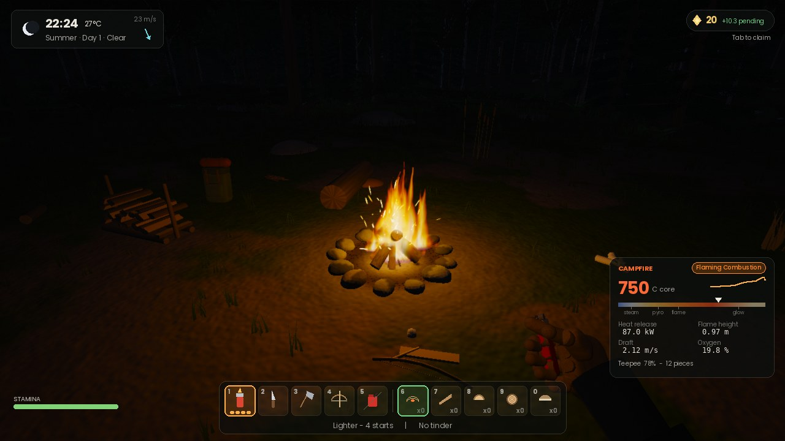
</p>

| | |
| :---: | :---: |
| 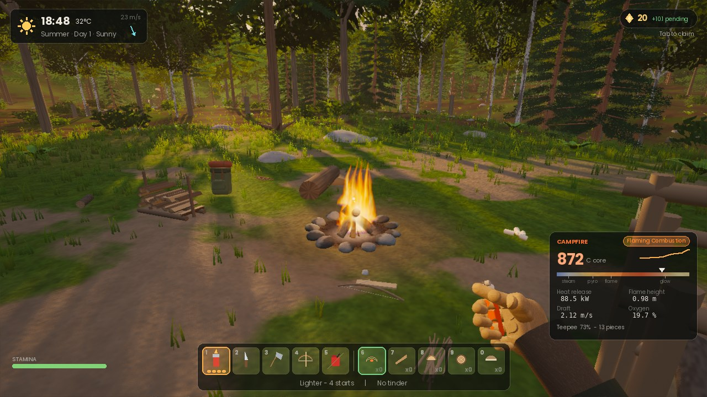 | 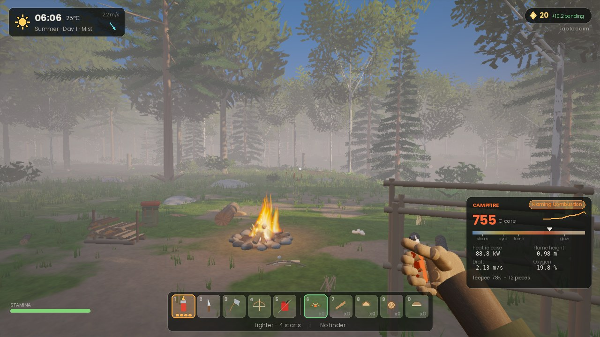 |
| 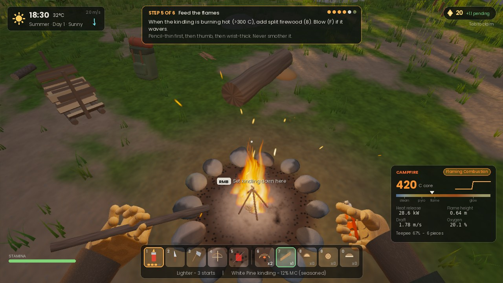 | 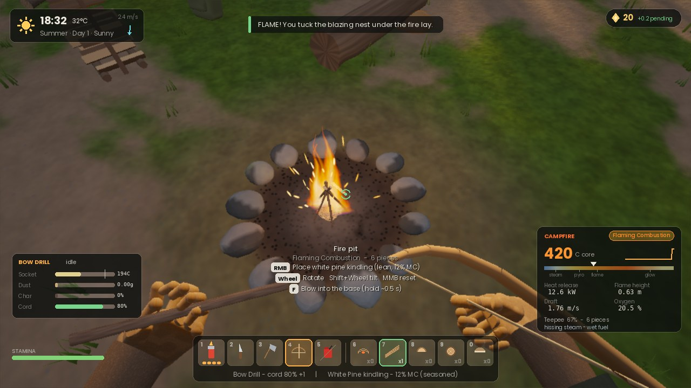 |
| 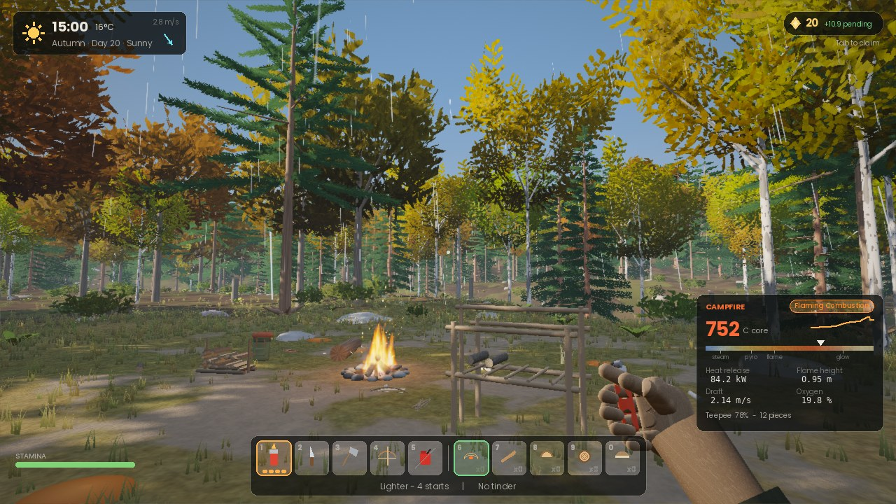 | 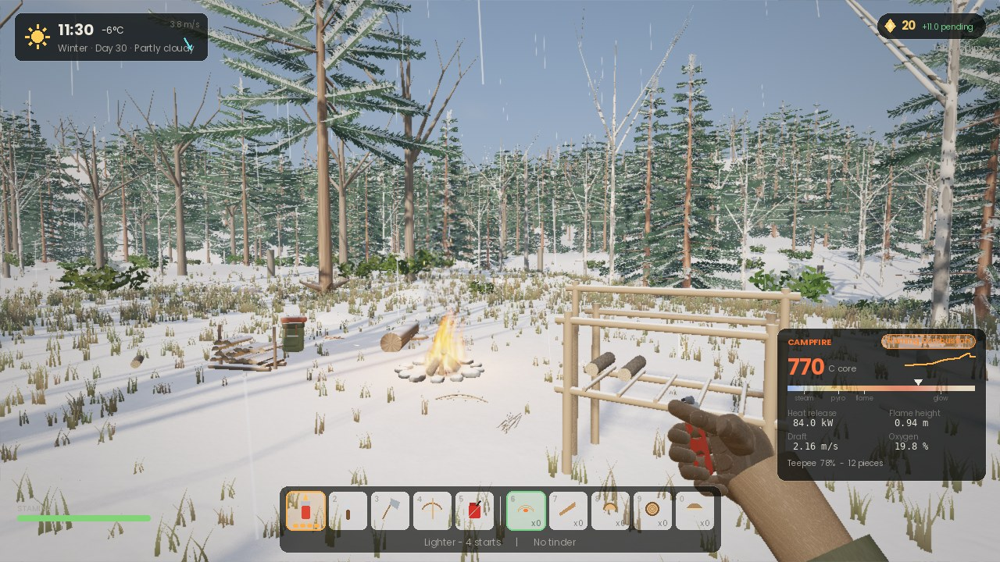 |
| 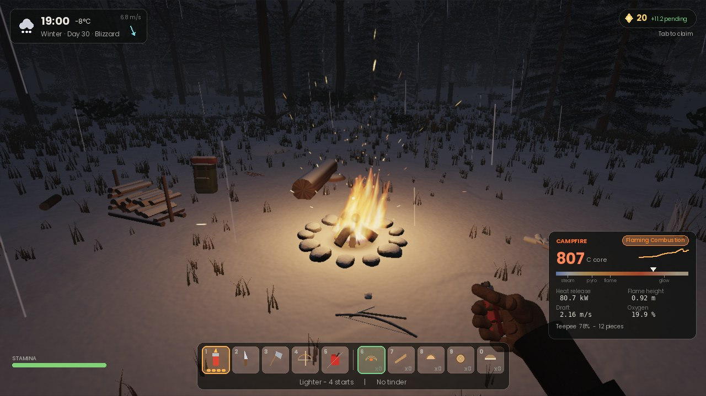 | 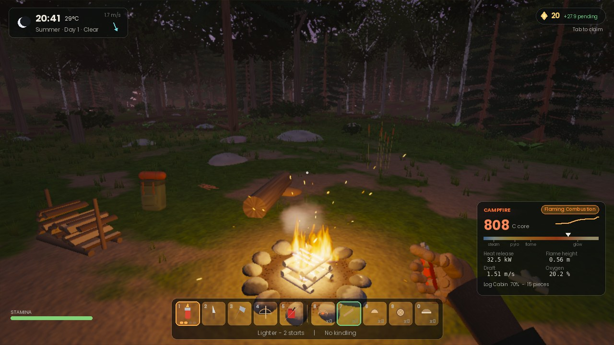 |
| 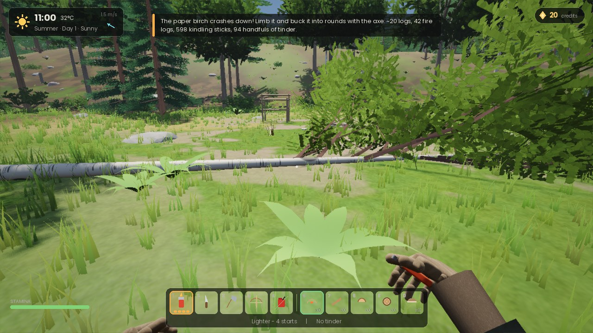 | 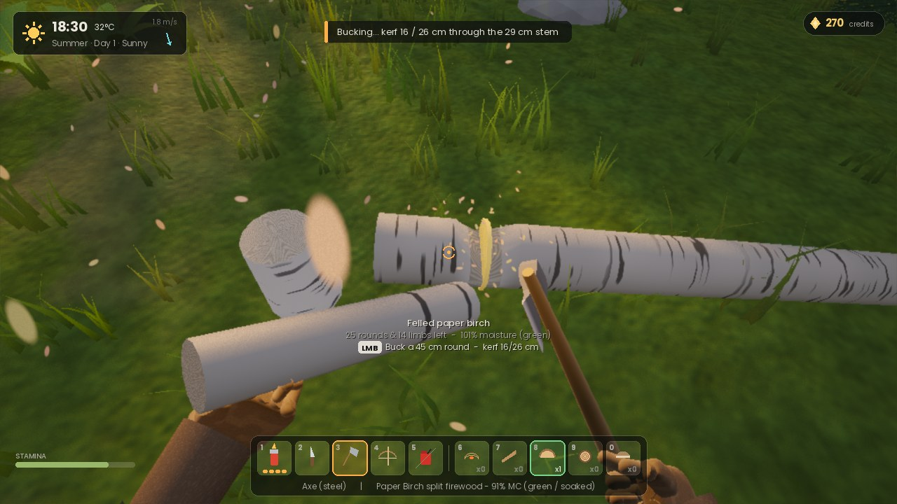 |
| 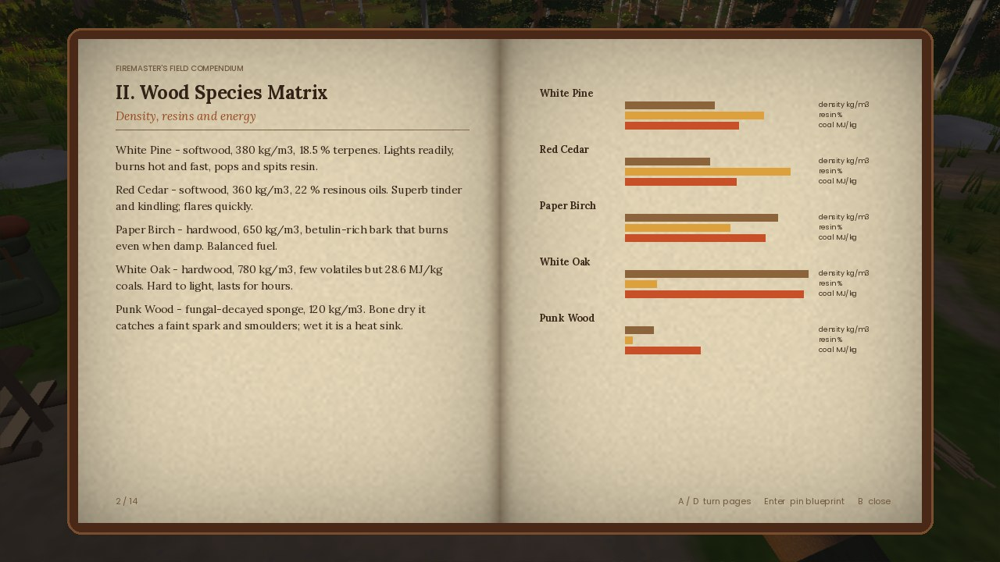 | 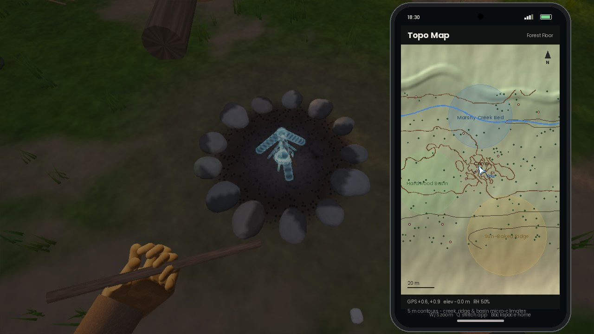 |

*All screenshots are captured automatically by the scripted playback test-suite (`run_tests.sh`).*

---

## Key Features

### 1. Rigorous Thermodynamic & Organic Simulation
* **Moisture Gradient Modeling**: Wood is simulated with independent surface and core moisture values. A log wet on the outside but dry inside will steam briefly before catching; a log dry on the outside but wet inside will ignite readily, only to sputter and choke as core moisture vaporizes and saps thermal energy.
* **Species-Specific Wood Chemistry**:
  * **Softwoods (Pine, Cedar)**: Rich in volatile terpenes and resins; low density; ignite at lower thresholds; produce intense, fast-burning flames.
  * **Hardwoods (Oak, Birch)**: Dense cellular structure; difficult to ignite; yield long-lasting, high-caloric charcoal beds.
  * **Punk Wood (Decayed Wood)**: Highly porous sponge. Bone-dry rot catches the faintest spark and smolders relentlessly; damp rot acts as a thermal heat sink that refuses to burn.
* **Airflow, Draft & The Vacuum Effect**: Construct fire structures (Teepee, Log Cabin, Swedish Torch, Lean-to) to generate natural convective chimneys. A well-designed draft pulls ambient oxygen into the ember bed, exponentially multiplying heat. Pack logs too tightly, and the fire suffocates.
* **Four-Phase Combustion**: Dehydration (endothermic steam release) → Pyrolysis (release of volatile smoke and gases) → Flaming Combustion (gas phase reaction) → Smoldering Charcoal (slow carbon oxidation) → Inert Ash.

### 2. Primitive Bushcraft & Tool Crafting
* **Hand-Operated Physicality**: First-person interactive hands reach, grab, align, carve, and strike.
* **Cordage & Bow Drills**: Use your pocket knife to strip inner fibrous bark from living trees, twist it into cordage, string a bow branch, cut a 45° V-notch into a dry hearthboard, and generate embers through sustained friction.
* **Hand Drill & Stone Bearing**: Press `4` twice to swap the bow for a 50 cm hand-drill spindle. Rub the mouse fast to spin it between your palms; hold `RMB` to press down with a smooth river stone (more force, slower slide down the spindle). Both drills work the same hearthboard socket, so the physics is shared: $P = \mu F_N \omega r$.
* **Ember Management & Coal Preservation**: Catch microscopic glowing coals in dry tinder nests (dry grass, pine needles, cedar shavings). Blow rhythmically to coax ember glow into self-sustaining flame. Harvest polypore and bracket mushrooms from rotting tree trunks to transport smoldering embers over miles and through days.

### 3. Forestry, Seasoning & Ecological Lifecycle
* **Wood Seasoning Systems**: Freshly cut green wood is saturated with sap. Build elevated drying racks to keep logs off moist soil, and cover them with tarps to shield against rain while allowing lateral airflow.
* **Time Passage Engine**: Advance time by hours, days, weeks, or months. Watch green oak logs slowly season to ideal 12% equilibrium moisture content, or watch unshielded ground logs rot into spongey decay.
* **Living Ecosystem**: Dynamic weather brings scorching summer sun, persistent autumn rains, and sub-zero winter blizzards. Trees drop seeds, saplings sprout, mature into forest canopy, die, rot into fungal host logs, and return nutrients to the soil.

### 4. Economy, The Smartphone & Tech Progression
* **Credit System**: Successfully building and maintaining hot, efficient fires awards research and survival credits.
* **Tab-Activated Smartphone**: Pull up your modern lifeline with the `Tab` key.
  * **Store App (`$`)**: Purchase essential gear—from replacement lighters and tarps to high-efficiency axes and costly liquid accelerants (lighter fluid, high-octane gasoline).
  * **Topo Map App**: View detailed topographical contours, forest biomes, moisture zones, and marked drying racks.
* **Firemaster's Reference Guide**: Unlock discovered and purchasable fire building recipes, cross-sections, and thermodynamic schematics.

---

## Controls

| Input | Action | Description |
| :--- | :--- | :--- |
| **W, A, S, D** | Move | Walk through the forest, slopes and the creek valley |
| **Shift** (hold) | Sprint | Faster, but drains stamina |
| **Ctrl** (toggle) | Crouch | Press to kneel right into the fire lay / at the hearthboard, press again (or sprint) to stand |
| **Mouse** | Look / Aim | Direct gaze and the interaction crosshair. While drilling, *horizontal* mouse motion saws the bow / rubs the spindle |
| **LMB** | Primary hand | Pick up / gather, hold the lighter flame, carve the V-notch, fell, limb & buck a felled tree, split rounds, drill (hold + saw), pour accelerant, stretch the tarp |
| **RMB** | Secondary hand | Place fuel in the pit (ghost preview) or on the drying rack, bear down on the bow / press the river stone, tip an ember into tinder, light / use the fungus ember carrier |
| **Scroll** | Rotate piece | Rotate the held stick or log before placing it |
| **Shift + Scroll** | Tilt piece | Lean a piece (0-90 deg) instead of the automatic teepee lean |
| **MMB** | Reset placement | Back to the automatic lean / lie-across-the-view placement |
| **1 - 5** | Tools | Lighter, Knife, Axe, Friction kit (press **4** again: bow drill <-> hand drill), Gasoline |
| **6 - 0** / **Q, E** | Off-hand fuel | Tinder, Kindling, Split firewood, Log, Fungus (Q / E cycle, including an empty hand) |
| **X** | Empty hands | Put everything away - nothing in either hand (you can still gather and pick things up) |
| **F** (hold) | Blow | ~0.3-0.8 s is a deep, even breath; too short cools the coal, too long scatters it |
| **C** | Twist cordage | Two strips of inner bark -> one bow-drill cord |
| **Tab** | Smartphone | Claim credits, Store, Topo Map (arrows / WASD navigate, Enter select, Q switch app, Backspace home) |
| **B** | Reference book | Fire recipes, species, moisture & seasoning science, field log; Enter pins a blueprint as a holographic guide |
| **T** | Pass time | 1 hour ... 90 days: the fire keeps burning through the skip with full physics (a log fire is still going after an hour and out by morning), racks season, ground logs rot, saplings grow |
| **H** / **F1** | Controls help | On-screen controls overlay |
| **Esc** | Pause / Settings | Volumes, graphics preset, mouse sensitivity, invert Y, sky clock speed, FPS counter |
| **F11** / **F12** | Fullscreen / Screenshot | Screenshots are saved in `screenshots/` |

Pausing (or the window losing focus) freezes the world and silences every sound except the menu clicks.

---

## Installation & Getting Started

### Prerequisites
* **Python 3.10+** (Python 3.11+ recommended for performance optimizations)
* A GPU / driver supporting **OpenGL 3.3 core** (any desktop GPU from the last decade; Mesa's
  software `llvmpipe` also works, slowly - that is what the headless test-suite uses)

### Setup Virtual Environment
```bash
# Clone the repository
git clone https://github.com/tndevteam-tommy/firestarter.git
cd firestarter

# Create and activate virtual environment
python -m venv .venv
# On Windows:
.venv\Scripts\activate
# On macOS/Linux:
source .venv/bin/activate

# Install dependencies
pip install -r requirements.txt
```

### Dependencies
* `moderngl` (OpenGL 3.3 rendering pipeline: shadows, HDR, bloom, ACES tone mapping, FXAA)
* `numpy` (vectorised fuel kernel, particles, procedural meshes & textures)
* `scipy` (DSP filters for the procedural audio synthesis)
* `pygame-ce` (window / GL context, keyboard & mouse, audio mixer)
* `pillow` (UI overlay, procedural leaf-texture atlas, screenshots)
* `pytest` (tests only - `requirements-dev.txt`)

No art or sound files are shipped: the first launch synthesises the ASMR sound bank into
`assets/audio/` (~4 s) and paints the foliage atlas into `assets/textures/` (~1 s).

### Running the Game
```bash
python main.py                       # play (window, audio, tutorial)
python main.py --preset Medium       # Low / Medium / High / Ultra (also in the Esc menu)
python main.py --no-tutorial --start-hour 21.5
python main.py --headless            # simulation-only smoke test, no window
python main.py --record my_session.json                      # record your input
python main.py --playback my_session.json --out captures/    # replay it (screenshots, report)
python main.py --help                # every option
```

---

## Early-Game Tutorial Walkthrough

The tutorial card at the top of the screen tracks six steps and completes each one by
watching what you actually do:

1. **Gather tinder**: aim at birch-bark curls, dry pine needles or dry grass and press `LMB`.
2. **Gather kindling**: collect pencil-thin dead twigs from the bundle beside the pit.
3. **Build the fire lay**: select tinder (`6`) and place it in the pit (`RMB`, a ghost shows where),
   then lean kindling (`7`) around it into a mini-teepee. Tip: press `B`, open *V. Teepee Fire*
   and press `Enter` to pin a holographic guide in the pit.
4. **Strike the lighter**: equip the lighter (`1`), crouch (`Ctrl`) close and *hold* `LMB` on the
   tinder. Each strike uses one of 4 fire starts - watch the gauge.
5. **Feed the flames**: once the kindling is burning (> 300 C) add split firewood (`8`) from the
   woodpile. Hold `F` for a deep breath at the base if it wavers.
6. **Claim your reward**: let it settle into glowing coals and open the phone (`Tab`) to bank your
   fire-mastery credits, then spend them in the Store (tarp, paracord, steel axe ...).

After that the whole forest is yours: fell a tree (notch, then back-cut) and work it up like a
woodcutter - **limb** it (cut each branch off at the trunk: thick branch wood becomes fire logs, the
rest green kindling and a bundle of twigs / bark / needles for tinder), **buck** the stem into 45 cm
rounds (a round comes free when both of its ends are cut; an amber ring shows where the next cut
falls, red if branches are still in the way) and **split** the big rounds (more blows and more
pieces the thicker they are). Stack the green wood on the raised rack, tarp it and pass 60 days;
make fire by friction with the bow drill or the hand drill; carry an ember for hours in a bracket
fungus.

---

## Testing: `run_tests.sh`

One command proves the game both **works** and **looks right**:

```bash
./run_tests.sh            # full run (~30 min on Mesa's llvmpipe software renderer, where it was verified)
./run_tests.sh --quick    # fast pass (skips slow tests, plays 2 of the 7 scripts)
./run_tests.sh --help     # options: --scripts 01,05  --no-gl  --no-playback  --clean
```

It creates / reuses `.venv`, installs `requirements-dev.txt`, and runs six stages (an X display
is used if present, otherwise the OpenGL stages run inside `xvfb-run`):

| Stage | What it checks |
| :--- | :--- |
| **1 unit** | 201 tests: combustion kernel (stages, moisture, green wood, choking, coal bed, energy balance), correlations (Heskestad, McCaffrey, stack effect), bow / hand drill, tinder & breath, fungi, felling, limbing & bucking yields, splitting, seasoning & punk rot, ecosystem, weather & solar geometry, credits / store / phone / map, blueprints & book, audio synthesis (clean, seamless, spectrally plausible), meshes, particles, lighting, hands, every UI screen, fires that keep burning through a time skip, and full gameplay driven through the real input layer (tutorial, bow drill -> flame, hand drill, felling -> bucking -> splitting -> rack -> tarp -> 60-day cure, gasoline, crouch toggle, empty hands, menus) |
| **2 headless** | `main.py --headless` builds and burns a teepee |
| **3 system** | entry points; the **live audio mix** recorded from SDL's disk driver (fire audible over the night ambience, crackle transients, no clipping, and silence while the game is paused) |
| **4 renderer** | the OpenGL renderer: every preset, resize, menus, night fire lighting, flame animation |
| **5 playback** | 7 scripted play sessions driven by real keyboard / mouse events (`automation/scripts/*.json`) with 131 gameplay assertions and 60 screenshots |
| **6 visual** | 90 objective image checks: every screenshot is tested (exposure, contrast, detail, colour, clipping) plus scene expectations: blue noon sky, warm golden hour, morning mist, night campfire pool of light, stars, autumn reds, snowy winter, flames that animate, crisp phone / book UI |

Everything lands in `test_artifacts/`: `report.html` (stages, every assertion, sounds heard,
frame timings, all screenshots with metrics), `contact_sheet.png`, JUnit XML and the PNGs.

Playback scripts are plain JSON (`automation/playback.py` documents every step type:
`key`, `click`, `aim_at`, `walk_to`, `saw`, `wait_until`, `assert`, `screenshot`, `expect_sound` ...);
`automation/scripts/generate_scripts.py` regenerates the bundled ones. Record your own session
with `--record` and replay it with `--playback`.

---

## Project Layout

```
main.py / game.py          entry point, game loop (fixed-step physics 60 Hz, thermal grid 20 Hz)
thermodynamics/            fuel kernel (segments x radial shells), combustion bodies, thermal grid
                           (flames, plumes, radiation, coal bed), airflow / draft, wood properties
bushcraft/                 bow drill, hand drill, tinder nest & breath, fungi, crafting controller
forestry/                  trees, felling, seasoning (rack / tarp / ground rot), ecosystem
simulation/                world manager (interaction, placement, physics), player, weather & sun,
                           terrain, inventory, time engine
economy/ recipes/          credits, store, phone, topo map; blueprints & the Field Compendium
input/                     input manager, procedural hand rig, tutorial
rendering/                 OpenGL renderer, shaders, procedural meshes & textures, particles,
                           atmosphere / exposure, UI overlay
audio/                     procedural sound synthesis + live spatial mixer
automation/                playback & recording, scene staging helpers, playback scripts
tests/                     unit, integration (GL, playback, audio capture), visual analysis
```

---

## Real-World Accuracy

The numbers players see come from published fire science, not tuning tables:

* **Pyrolysis**: hemicellulose / cellulose / lignin / extractives as four Arrhenius pools; char yields
  per species; heat of gasification flame-zone model (cone-calorimeter-like 150-250 kW/m^2 peaks).
* **Ignition**: thin / thick-fuel piloted-ignition times, critical mass flux, moisture of extinction;
  green wood (80-110 % MC) steams and hisses but will not flame.
* **Flames & plumes**: Heskestad flame height, McCaffrey plume temperatures, radiative view factors.
* **Coals**: kinetic / diffusion-limited char oxidation, Arthur's CO/CO2 ratio, Boudouard
  gasification that keeps glowing coals at ~900-1100 C, insulating ash.
* **Draft**: stack effect and Bernoulli base vacuum exactly as in DESIGN 2.4; edge-to-edge logs choke.
* **Friction fire**: $P = \mu F_N \omega r$ heating a ~0.45 g socket; 45 deg V-notch dust charring to a
  380 C ember in ~40-80 s of good bowing. Exhaled breath carries ~16.5 % O2.
* **Seasoning**: Hailwood-Horrobin EMC, diffusion time ~ r^2 (split wood cures ~4x faster), a
  tarped summer rack takes green oak to ~12 % in about 60 days; wet ground rots logs into punk wood.
* **Sky**: real solar geometry at 45 N (sunrise/sunset, seasonal sun height, moon), climatology
  per season.

See `DESIGN.md` section 10 for the implementation notes and the two places where the design table
values were corrected to physical magnitudes.

---

## Visual & Atmospheric Philosophy
*Firestarter* aims for grounded, natural beauty rather than a cartoon look: physically based
lighting with painterly touches.
* **Fire** is the centrepiece: turbulent, licking flame sheets coloured by soot temperature, glowing
  char fissures on the wood, an ember bed with blue CO flames, sparks that cool from yellow to red,
  heat shimmer, bloom, and a flickering inverse-square firelight that the eye adapts to at night.
* **Smoke tells the chemistry**: white steam from wet wood, thick yellow-grey pyrolysis smoke from
  a smouldering or choked fire, and only thin wisps above a clean, hot fire.
* **A living forest**: pines, cedars, oaks and birches built from thousands of leaf and needle spray
  cards (procedurally painted), wind sway, dappled soft shadows, seasonal colours, snow cover.
* **Sky & weather**: accurate sun path, golden hours, twilight, stars and the Milky Way, morning
  mist, rain streaks lit by the fire, snowfall, wet ground.
* **ASMR-grade field audio**: every sound is synthesised - crackling resin pops, roaring flames,
  hissing sap, friction squeaks, footsteps on leaves / snow / water, birds by day and crickets by
  night, spatialised around the player.
